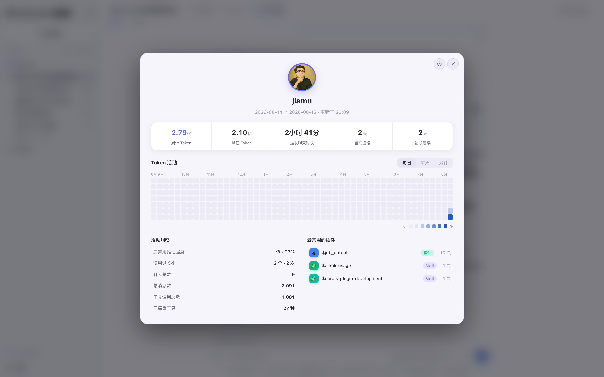
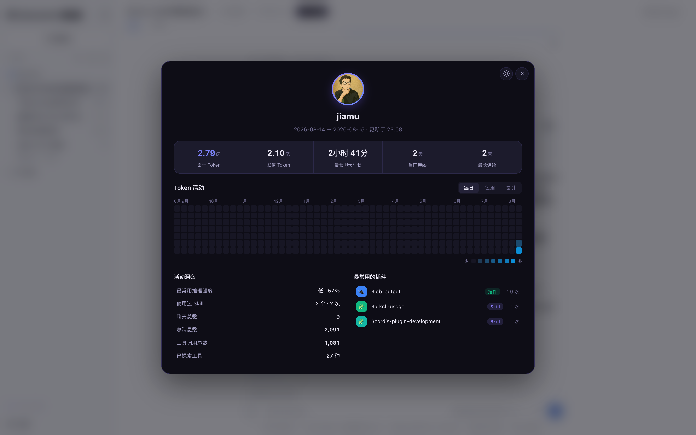
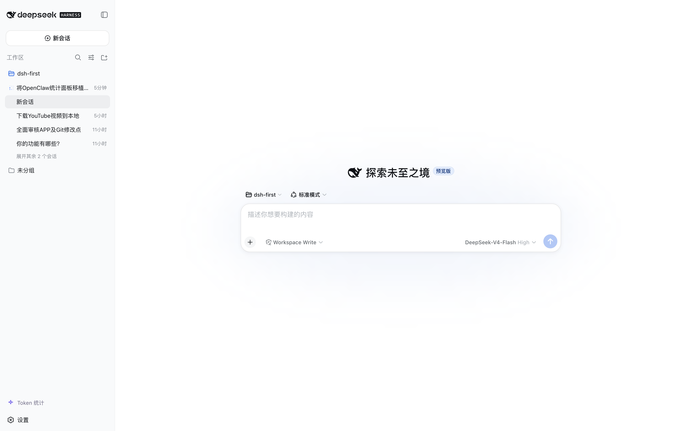

# dsh-token-usage

**English** · [中文](./README.md)

**Token usage stats panel for DSH** — Codex usage-page style. See your whole DeepSeek Harness instance's token consumption at a glance: totals / per-session peaks, activity heatmap, top plugins.


## What is this?

DSH just launched, and the first thing everyone wants to know is: **where did my tokens go?**

This plugin adds a token-usage stats panel to the DSH web UI, aggregating token consumption across **all sessions** of the running instance. Click any entry point to open the centered panel (dark / light theme):




## Features

- **5 headline metrics**: total / per-session peak tokens, longest chat duration, current / longest streak
- **Token activity heatmap**: daily (GitHub contribution graph) / weekly (bars) / cumulative (line) views with hover tooltips
- **Activity insights (incl. top model) + top 5 plugins / skills**: see who is burning the most at a glance
- **Two native entry points**, blended into the DSH UI:
  - "Token 统计" button at the bottom of the sidebar (always available)
  - Live usage capsule in the session header: `⚡ 2.61亿` (5s while the panel is open, low-frequency when closed)
- **Incremental statistics, zero log decompression on warm start**: per-session aggregates are
  persisted in DSH's projection cache, so a restart only reads one cache row per session;
  only uncached sessions pay a one-time cold read
- **Deep-space purple dual theme**, follows the system / manual toggle



## Why install it

- **See where tokens go**: totals, per-session peaks, and the daily heatmap — no more guessing
- **Zero learning curve for Codex users**: the familiar usage-page style, instantly readable
- **A natural thing to share**: everyone loves posting "look how many tokens I burned today" — one screenshot is the best marketing

## Installation

Requires DSH **0.2.1 or newer**. The plugin depends on DSH's built-in packages (`@deepseek-ai/*`), which the runtime resolves itself — there is nothing extra to build.

### Option 1: Install straight from GitHub (recommended)

No clone, no local copy of the source — one command:

```sh
dsh plugin --profile web add github:gaodayihao/dsh-token-usage
```

Prefer to let an agent do it? Send it this sentence:

> Take a look at this repo: https://github.com/gaodayihao/dsh-token-usage , then install dsh-token-usage on my DSH.

Or skip the terminal: in the Web UI open **Plugins → Add plugin** and enter the same spec
`github:gaodayihao/dsh-token-usage` (DSH accepts the `github:` shorthand; when GitHub is unreachable the dialog offers a mirror).

**Why this repo installs cleanly from Git**: the built artifacts under `lib/` are committed, and the package
declares **no `prepare` / `postinstall` script** — pnpm runs no build and leaves no pending
`allowBuilds: { dsh-token-usage: set this to true or false }` entry (a Git-hosted plugin that does carry a
`prepare` script is held back by pnpm 11 until you approve it in the profile's `pnpm-workspace.yaml`).
What you install is ready to run.

Requirements: `git` on the machine (pnpm first runs `git ls-remote <repo> HEAD` to resolve the ref, then
downloads that commit's tarball) and reachability of github.com — behind a restrictive network, use a proxy
or the mirror the install dialog offers.

Pin a tag or commit to freeze the version:

```sh
dsh plugin --profile web add "github:gaodayihao/dsh-token-usage#v0.2.0"
```

Without a ref, pnpm pins the commit it resolved into `pnpm-lock.yaml`, so a running instance is never swapped
out just because the branch moved. To move to the newest commit on the default branch:

```sh
dsh plugin --profile web update dsh-token-usage
```

(`update` re-resolves a `github:` spec to the new commit on the default branch; if it does not move, run
`dsh plugin --profile web remove dsh-token-usage` and `add` it again as above.)

`dsh plugin` uses DSH 0.2.x's native bundle installation: it records the package in
`~/.dsh/profiles/web/package.json` under `dependencies` and `dsh.profile.bundles`, applies the bundled
`cordis.patch.yml`, and inserts the plugin row into the load tree. Use another `--profile` name (e.g. `tui`)
to install elsewhere.

Then restart `dsh web` and refresh the page.

> **This repository is a fork of [`jiamuAi/dsh-token-usage`](https://github.com/jiamuAi/dsh-token-usage).**
> Upstream `main` is still 0.1.0 (2026-08-15) and fails to load on DSH 0.2.1 because its TYPERT manifest and
> client bundle name a package that does not exist (upstream issue #1); this fork carries the fix.
> Once it lands upstream, replace `gaodayihao` with `jiamuAi` above.

### Option 2: Local source (when you edit the plugin)

```sh
git clone https://github.com/gaodayihao/dsh-token-usage.git
dsh plugin --profile web add "file:$(pwd)/dsh-token-usage"
```

`file:` installs a directory dependency, so rebuilding `lib/` and reinstalling shows local edits — handy while
developing. For distribution, use the `github:` route above.

### ⚠️ A local source install must use `file:` — never `link:` or a bare path

Passing a bare absolute path (no `file:` prefix) makes pnpm record the dependency as `link:`, and
**`link:` does not install the package's dependencies**. `lib/typert.host.js` does `import { z } from 'zod'`;
with `link:` the plugin directory is not under the profile's `node_modules`, so `zod` can never resolve:

```
typert-loader: dsh-token-usage exports "./typert" but importing ... failed:
  Cannot find package '.../node_modules/zod/index.js'
```

A single failed contributor aborts the whole typert registration round — so the consequence is not one broken
plugin but every Remote endpoint losing its strict definition, which breaks the DSH UI (empty workspace list;
the directory picker reports
`directoryPicker/pick: its strict definition was withdrawn and SRC fallback is forbidden`).
No data is lost (`~/.dsh/storages/workspace.json` and the session logs are intact); remove the dependency and
restart to recover.

Both `file:` and `github:` **do** install dependencies (you will see `zod` under the package's
`node_modules`); only `link:` does not — the GitHub route above is free of this trap.

To confirm an install, run this afterwards (point the path at the installed copy inside the profile):

```sh
node -e "import('file:///C:/Users/<you>/.dsh/profiles/web/node_modules/dsh-token-usage/lib/typert.host.js').then(m => console.log(m.TYPERT))"
```

A printed `TYPERT` object means it works; "cannot find zod" means it went in as `link:` — remove and reinstall.

> **Upgrading from 0.1.x**: remove the old dependency (`dsh plugin --profile web remove dsh-token-usage`),
> install again as above, delete any leftover `@deepseek-ai/dsh-invariants` or `/invariant` row from the
> profile config (DSH dropped the `invariants` service in v0.2.0-rc.2), then restart `dsh web`.
>
> **The 0.1.x method is gone**: copying the source into `<deepseek-harness>/packages/extensions/` and running
> `pnpm run build:lib` loses those files on every DSH update. The profile installation above lives under
> `~/.dsh/profiles/` and survives DSH updates.

## Usage

1. After restart, the **"Token 统计" entry appears at the bottom of the sidebar**
2. Open any session — the **live capsule `⚡ 2.61亿` shows next to the title**
3. Click either entry to open the panel; toggle theme / close from the top-right
4. The heatmap supports three views + hover tooltips for daily / weekly / cumulative values

While the panel is open it refreshes every 5 seconds; closed, it drops to 60 seconds (the
capsule keeps data). Opening the panel triggers an immediate refresh.

The first install needs one background backfill: the heatmap title shows "统计中 312/907"
until every session has been covered, then the badge disappears. Backfill runs newest-first,
with bounded concurrency, and never blocks DSH's main flow. After that, restarts do not
decompress any historical log — each session's aggregate lives in DSH's projection cache
(`~/.dsh/storages/session_projcache/`).

## Data accounting

Consistent with DSH's built-in token-meter:

- One usage settlement per step: `assistant/message.usage` is authoritative;
  `assistant/attempt` contributes the last usage sample embedded in its stream (the real cost of a
  retried attempt); `llm/retry-started` resets the dedupe slot so a retried settlement replaces
  rather than double-counts the same step
- Legacy v3 logs' `assistant/chunk {type:'usage'}` is still folded (v4 logs no longer emit it)
- Total tokens = input + output + cacheRead + cacheWrite
- Thinking level prefers `request/header`'s `reasoningEffort` (the level DSH actually sent) and
  falls back to a `reasoningTokens` approximation only for old logs without that event; skill
  stats are parsed from `skill` tool call arguments

## Architecture

```
┌─ Host (inside the DSH process) ─────────────────────────────────────┐
│ TokenUsageService (TypertRemoteService)                             │
│  ├─ dtsUsage projection unit (bounded per-session aggregate)        │
│  ├─ Boot: sessionProjectionCache.cachedSnapshot() → zero log I/O   │
│  ├─ Miss: coldSnapshot() reads the log once and writes back         │
│  ├─ Live: sessionProjections.onChanged → in-memory rollup           │
│  ├─ No projection services? self-persisted rollup + log revision    │
│  └─ @Remote('getStats') → /api/tokenUsage/getStats                  │
└──────────────┬──────────────────────────────────────────────────────┘
               │ connection.rpc (generic channel, no DSH edits)
┌─ Browser ────▼──────────────────────────────────────────────────────┐
│  ├─ sidebar.footer.action        sidebar entry                     │
│  ├─ conversation.session.header.actions ⚡ capsule                  │
│  └─ shell.overlay                panel modal                        │
└────────────────────────────────────────────────────────────────────┘
```

| File | Purpose |
|---|---|
| `src/index.ts` | Host half: projection unit / cache reads / cold backfill / fallback persistence + Typert Remote |
| `src/aggregate.ts` | Pure aggregation (no DSH runtime): `createSessionState` / `applySessionEvent` / `sessionView` / `buildGlobalSnapshot` |
| `src/client/index.ts` | Browser half: panel UI + two entry points + progress badge + adaptive polling |
| `src/types.ts` | Cross-plane wire types (incl. `backfill` progress) |
| `scripts/build-lib.mjs` | Generates `lib/` from `src/` (Node 24 type stripping, no DSH toolchain) |
| `cordis.patch.yml` | Bundle patch: inserts the plugin row |
| `lib/` | Committed build artifacts (runs as-is, no build needed) |

## Development

`lib/` ships prebuilt — **regular users don't need to build**. To change code, use the bundled builder:

```sh
node scripts/build-lib.mjs          # regenerate lib/types/*.js and lib/client.js
node scripts/build-lib.mjs --check  # verify lib/ is in sync with src/
```

It uses Node 24's `module.stripTypeScriptTypes` for type-only compilation, so no DSH
toolchain (tsc/tsdown) is required. Two generated artifacts are maintained by hand:
`lib/typert.host.js` / `lib/typert.remote-client.js` (Typert strict result schemas — the
build script checks that `backfill` is present) and the `.d.ts` declarations.

### Releasing (maintainers)

A GitHub install serves **committed files**, so every release must:

1. Sync `src/` and `lib/` before committing (`lib/` left behind = users install stale code);
2. Add no `prepare` / `preinstall` / `postinstall` script — with one present, pnpm 11 suspends the build
   script until `allowBuilds` is approved and direct installs stop working out of the box;
3. Tag and push so users can pin a version:

   ```sh
   git tag v0.3.0 && git push origin main --tags
   ```

4. Verify once in a clean environment: `dsh plugin --profile web add "github:gaodayihao/dsh-token-usage#v0.3.0"`.

## License

[MIT](./LICENSE)

---

Made for the DSH community · Star / Issue / PR welcome
