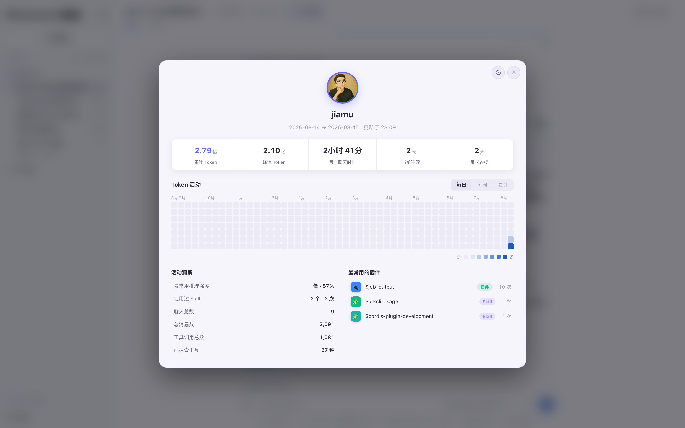
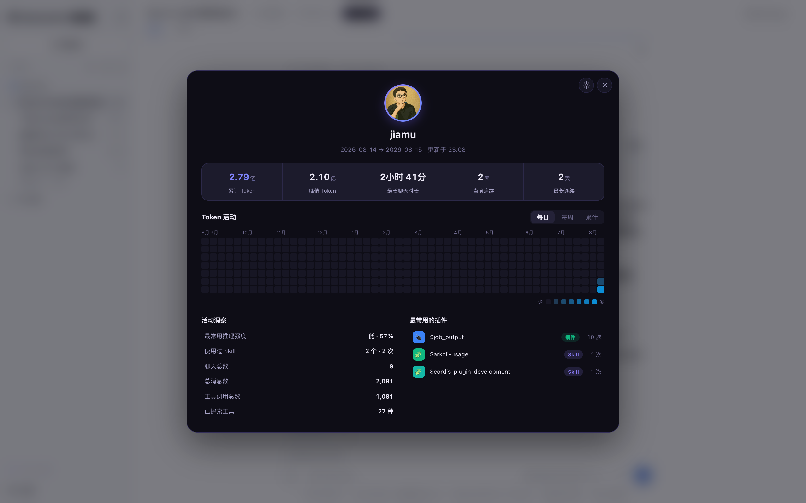
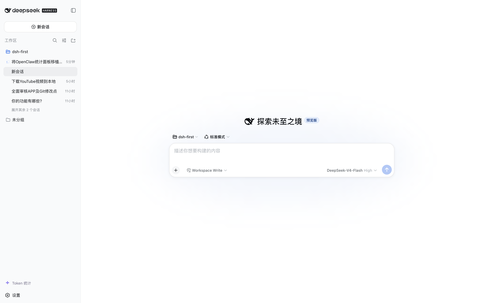

# dsh-token-usage

**中文** · [English](./README.en.md)

**DSH 的 Token 用量统计面板** —— 仿 Codex 个人用量页风格，把整个 DSH 实例的 Token 消耗一目了然地展示出来：累计 / 单会话峰值、活动热力图、插件 Top5。


## 这是什么

DSH 刚发布，大家最关心的就是：**我的 Token 到底花哪去了？**

这个插件在 DSH Web 界面里加一个 Token 用量统计面板，把当前运行实例**全部会话**的 token 消耗汇总，点击入口即弹出居中面板（深色 / 浅色主题）：




## 特性

- **5 大指标**：累计 / 单会话峰值 Token、最长聊天时长、当前 / 最长连续天数
- **Token 活动热力图**：每日（GitHub 贡献图）/ 每周（柱状）/ 累计（折线）三视图，悬浮看数值
- **活动洞察（含最常用模型）+ 插件 / Skill Top5**：谁在消耗最多，一目了然
- **两个原生入口**，与 DSH UI 融为一体：
  - 侧边栏底部「Token 统计」按钮（应用级常驻）
  - 会话头部实时用量胶囊：`⚡ 2.61亿`（面板打开时 5 秒刷新，关闭时低频刷新）
- **增量统计，冷启动零日志解压**：会话聚合持久化在 DSH 的投影缓存里，启动只读
  每个会话的缓存行；只有没缓存的会话才冷读一次原始日志，之后永久命中
- **支持补回丢失历史**：日志被误删/磁盘损坏导致统计缺口时，可用「历史基线导入」
  把截图/外部记录里的汇总并进面板（标注来源与估算，删文件即回滚）
- **深空紫双主题**，跟随系统 / 手动切换



## 为什么值得装

- **一眼看清 Token 去向**：累计、单会话峰值、每日热力图，不用再猜
- **Codex 用户零学习成本**：熟悉的用量页风格，界面一看就懂
- **天然的传播素材**：大家都喜欢晒"我今天用了多少 token"，截一张图发出去，就是最好的宣传

## 安装

需要 DSH **0.2.0-rc.2 或 0.2.1 系列**（含 `0.2.0-rc.2`、`0.2.1-alpha.x` 等预发布版），即
`peerDependencies` 声明的 `>=0.2.0-0 <0.3.0`（`@deepseek-ai/cordis` 为 `>=4.0.4`）。
桌面版与源码编译版都落在这个区间内。插件依赖 DSH 内置包（`@deepseek-ai/*`），运行时由 DSH
自己解析，无需额外构建，也**不需要**用 `dsh plugin allow-version` 开兼容性豁免。

### 方式一：直接从 GitHub 安装（推荐）

不用克隆仓库、本地也不用留一份源码，一条命令装好：

```sh
dsh plugin --profile web add github:gaodayihao/dsh-token-usage
```

不想开终端，也可以把这句话发给 DSH Agent，让它自己读仓库说明并装好：

> 你看一下这个仓库：https://github.com/gaodayihao/dsh-token-usage ，然后帮我把 dsh-token-usage 安装到我的 DSH 上。

或者在 Web 界面走 **插件 → 添加插件**，填入同样的规格
`github:gaodayihao/dsh-token-usage`（DSH 认 `github:` 简写；连不上 GitHub 时界面会提示改用国内镜像）。

**为什么这个仓库能直装**：仓库里已提交构建产物 `lib/`，并且**没有 `prepare` /
`postinstall` 脚本** —— pnpm 不会执行任何构建，也不会留下
`allowBuilds: { dsh-token-usage: set this to true or false }` 这种待审批条目
（带 `prepare` 的 Git 插件会被 pnpm 11 拦下，必须先去 profile 的
`pnpm-workspace.yaml` 里逐个放行）。装完即是可运行状态。

前提：本机有 `git`（pnpm 先用 `git ls-remote <repo> HEAD` 解析 ref，再下载该 commit 的
tarball），并且能访问 github.com —— 国内网络可走代理，或在 Web 界面按提示改用镜像源。

想锁死版本就带上 tag 或 commit：

```sh
dsh plugin --profile web add "github:gaodayihao/dsh-token-usage#v0.2.0"
```

不带 ref 时，pnpm 会把这次解析到的默认分支 commit 钉进 `pnpm-lock.yaml`，
已经在跑的实例不会因为仓库有新提交就被换掉；要挪到默认分支的最新 commit 用：

```sh
dsh plugin --profile web update dsh-token-usage
```

（`update` 会把 `github:` 规格重新解析到默认分支的新 commit；万一没动，就先
`dsh plugin --profile web remove dsh-token-usage`，再按上面的 `add` 装一次。）

`dsh plugin` 走的是 DSH 0.2.x 的原生 bundle 安装：把它写进 `~/.dsh/profiles/web/package.json`
的 `dependencies` 和 `dsh.profile.bundles`，并自动应用包内的 `cordis.patch.yml`，
把插件行插进加载树。装到别处就换 `--profile` 的名字（如 `tui`）。

最后重启 `dsh web`，刷新页面即可看到入口。

> **本仓库是 [`jiamuAi/dsh-token-usage`](https://github.com/jiamuAi/dsh-token-usage) 的 fork。**
> 上游 main 仍是 0.1.0（2026-08-15），在 DSH 0.2.1 上会因 TYPERT manifest /
> client bundle 写错包名而加载失败（见上游 issue #1）；本 fork 已含修复。
> 等修复合并回上游后，把上面的 `gaodayihao` 换成 `jiamuAi` 即可。

### 方式二：本地源码（改插件代码时用）

```sh
git clone https://github.com/gaodayihao/dsh-token-usage.git
dsh plugin --profile web add "file:$(pwd)/dsh-token-usage"
```

`file:` 装的是目录依赖，本地改完 `lib/` 重装即生效，适合开发调试；
对外分发请用上面的 `github:` 装法。

### ⚠️ 装本地源码时必须用 `file:`，不要用 `link:` 或裸路径

`dsh plugin --profile web add <绝对路径>`（不加 `file:` 前缀）会被 pnpm 记成
`link:`，而 **`link:` 不会安装该包的依赖**。本插件生成的 `lib/typert.host.js`
里有 `import { z } from 'zod'`，`link:` 之后插件目录不在 profile 的 `node_modules`
之下，zod 永远解析不到，于是：

```
typert-loader: dsh-token-usage exports "./typert" but importing ... failed:
  Cannot find package '.../node_modules/zod/index.js'
```

而 typert-loader 只要有一个 contributor 注册失败，**整轮注册都会中止** ——
后果不是插件单独失效，而是所有 Remote 端点都失去 strict 定义，DSH 界面会整体崩掉
（工作区列表空白、目录选择器报
`directoryPicker/pick: its strict definition was withdrawn and SRC fallback is forbidden`）。
数据不会丢，`~/.dsh/storages/workspace.json` 和会话日志都还在，移除该依赖重启即可恢复。

`file:` 与 `github:` 都**会**正常安装依赖（package 的 `node_modules` 里能看到 `zod`）；
只有 `link:` 例外。上面的 GitHub 直装因此没有这个坑。

要确认装对了，可以在装完后跑一次（把路径换成 profile 里的安装副本）：

```sh
node -e "import('file:///C:/Users/<你>/.dsh/profiles/web/node_modules/dsh-token-usage/lib/typert.host.js').then(m => console.log(m.TYPERT))"
```

打印出 `TYPERT` 对象就算通过；报 zod 找不到就是装成了 `link:`，卸掉重装。

### 从 0.1.x 升级

1. 若 `~/.dsh/profiles/web/package.json` 里已有一条旧的 `dsh-token-usage` 依赖，
   先 `dsh plugin --profile web remove dsh-token-usage`，再按上面重新安装
   （GitHub 直装，或本地源码加 `file:` 前缀）。
2. 若 profile 配置（`cordis.yml` / `cordis.patch.yml` / `--patch`）里有 `name` 为
   `@deepseek-ai/dsh-invariants` 或以 `/invariant` 结尾的行，请删掉 —— DSH
   v0.2.0-rc.2 起不再发布 `invariants` 服务与任何 `<包>/invariant` 子路径。
3. 重启 `dsh web` 并刷新页面。

> **0.1.x 的老装法已废弃**：以前是把源码拷进 `<deepseek-harness>/packages/extensions/`
> 再跑 `pnpm run build:lib`。DSH 更新会覆盖仓库目录，拷进去的文件随之丢失，插件于是"失效"。
> 请改用上面的 profile 安装方式，它写在 `~/.dsh/profiles/` 下，不受 DSH 更新影响。

### 装不上：`installation rejected: ... is incompatible with dsh <版本>`

安装时 DSH 会拿插件 `package.json` 里的 `peerDependencies` 与当前运行时版本做
semver 比对，不满足就整单拒绝并回滚（日志里还会附带一句 pnpm 的 `allowBuilds` 提示
—— 本仓库没有 `prepare` 脚本，那句是通用提示，不是实际原因）：

```
dsh: installation rejected: Plugin dsh-token-usage@<插件版本> is incompatible with dsh <运行时版本>:
peerDependencies {"@deepseek-ai/dsh-client-connection":"...","@deepseek-ai/dsh-session":"..."}
```

处理顺序：

1. **优先升级插件**：`0.2.1` 起本插件的 peer 范围是 `>=0.2.0-0 <0.3.0`，桌面版
   `0.2.0-rc.2` 与源码版 `0.2.1-alpha.x` 都满足。装最新代码即可：
   `dsh plugin --profile desktop add github:gaodayihao/dsh-token-usage`
   （已在跑旧版则先 `remove`，或改用 `update`。）
2. **确认运行时版本**：`dsh --version`（桌面版在 设置 → 通用 里也能看到）。若你的版本
   不在 `>=0.2.0-0 <0.3.0` 内，请提 issue，不要靠豁免硬装。
3. **只有确认过风险才用豁免**：exemption 只对「精确的插件版本 + 精确的 DSH 版本」生效，
   升级插件或升级 DSH 后都会失效，需要重新授权。它不改变依赖，只是放行：

   ```sh
   dsh plugin --profile desktop allow-version dsh-token-usage@<插件版本> \
     --dsh-version <运行时版本> --accept-risk
   ```

   撤销用 `revoke-version`，查看已授权列表用 `version-exemptions`。豁免记录写在 profile 的
   `compatibility.json` 里。

> 旧版本（`0.2.0`）声明的是 `^0.2.1-alpha.1`，在桌面版 `0.2.0-rc.2` 上会被这道闸门拦下。
> 注意 `0.2.0-rc.2 < 0.2.1-alpha.1`，所以「0.2.1 的预发布」并不覆盖「0.2.0 的预发布」——
> 想在两类运行时上通用，下界必须写到 `0.2.0-0` 这种带预发布的形式。
>
> 另外：`github:` / tarball 这类规格是**先装、再校验**兼容性，判定不通过时才回滚——所以你会
> 在日志里看到 `dsh: restored package.json, pnpm-lock.yaml, and node_modules.`。registry 与
> 本地路径规格则是**先校验、后安装**（不通过就什么都不装）。两者最终都不影响仓库，重装即可。

### 装完报 `allowBuilds` / 构建被 pnpm 挂起

本仓库**提交了构建产物 `lib/`**，且 `package.json` 里**没有 `prepare` / `preinstall` /
`postinstall`**，pnpm 不会执行任何构建，也不会留下待审批的 `allowBuilds` 条目 ——
所以**不需要**往 profile 的 `pnpm-workspace.yaml` 加任何东西。

那句 `allowBuilds` 提示的实际触发条件是「`pnpm add` 退出码非 0 **且** 安装规格看起来像
git 地址（`git+` / `github:` / `.git`）」—— 它是一条通用提示，**不是**「pnpm 真的挂起了
构建」的证据。上面那种兼容性拒绝会让整单失败，于是这条提示也会跟着出现（你看到的日志
就是这种情况）。真正的「构建被挂起」是另一个机制：安装失败类型 `build-blocked` 加
`pendingBuilds` 列表，由插件管理器单独上报。

## 使用

1. 重启后，**左侧栏底部**出现「Token 统计」入口
2. 打开任意会话，**标题旁**出现实时用量胶囊 `⚡ 2.61亿`
3. 点击任一入口打开面板；右上角可切主题、关闭
4. 热力图支持三视图切换 + 悬浮看单日 / 单周 / 累计数值

面板打开时每 5 秒刷新一次，关闭后降频到 60 秒（胶囊仍有数据）；面板打开瞬间立即刷新。

历史会话首次安装需要一次后台回填：热力图标题旁会显示「统计中 312/907」，
数字逐步长满后徽标自动消失；回填按会话从新到旧进行、限并发、不阻塞 DSH 主流程。
回填完成后的重启不再解析任何历史日志（每个会话聚合已持久化在
`~/.dsh/storages/session_projcache/` 的投影缓存里）。

## 数据口径

与 DSH 内置 token-meter 一致：

- 每 step 一条 usage 结算：`assistant/message.usage` 是权威记录；`assistant/attempt`
  取 stream 内最后一个 usage 样本（重试尝试的真实消耗）；`llm/retry-started` 复位
  去重槽，同一步的重复结算按“替换”记账（差值计入总量），不重复计数
- 兼容旧 v3 日志的 `assistant/chunk {type:'usage'}`（v4 日志里不再出现）
- 累计 Token = input + output + cacheRead + cacheWrite
- thinking 等级优先取 `request/header` 的 `reasoningEffort`（DSH 实际下发档位），
  没有该事件的旧日志才回退 `reasoningTokens` 近似；Skill 统计从 `skill` 工具调用参数解析

## 补回丢失的历史（历史基线导入）

如果一段时间的会话日志已经丢失（误删、磁盘损坏、换机），又想把那段 Token 统计
补回面板，可以在 DSH 数据目录放一个**历史基线文件**：

```
~/.dsh/storages/dsh-token-usage/history-baseline.v1.json
```

插件启动后（以及文件 mtime 变化后 5 秒内）会加载它，并与真实会话汇总合并：

- 累计 Token / 会话数 / 消息数 / 工具调用 / 峰值 / 最长时长：相加或取较大值；
- 每日 token：按日期相加，热力图直接补出那段时间的颜色；
- 连续天数：按"基线活跃日期 ∪ 真实会话日期"重新计算；
- thinking / 模型明细：基线没有提供时沿用真实会话的分布。

示例：

```json
{
  "version": 1,
  "label": "2026-08-26 ~ 2026-10-10（磁盘损坏前，按截图导入）",
  "range": ["2026-08-26", "2026-10-10"],
  "totalTokens": 42135000000,
  "peakTokens": 2309000000,
  "maxDurationSec": 35820,
  "totalConversations": 1137,
  "totalMessages": 153724,
  "totalToolCalls": 194617,
  "distinctTools": 228,
  "topPlugins": [["pwsh", 49556], ["mcp__vs-mcp-ursa__FindSymbols", 5101]],
  "dailyTokens": { "2026-08-26": 310000000, "2026-09-23": 2789000000 },
  "dailyEstimated": true,
  "activeDates": ["2026-08-31", "2026-09-01"]
}
```

- 面板会在副标题和「活动洞察」里标注 `含导入历史 <起> → <止>（估算）`；
- **删除这个文件即完全回滚**（免重启，5 秒内生效），不会影响真实会话与投影缓存；
- 基线时段不要与真实数据重叠，否则会重复计数；
- 本仓库的 `scripts/history/build-baseline.mjs` 是一个从截图还原基线的示例脚本
  （本次用它还原了 2026-08-26 → 2026-10-10 的数据）。

## 架构

```
┌─ Host（DSH 进程内）────────────────────────────────────────────────┐
│ TokenUsageService (TypertRemoteService)                            │
│  ├─ dtsUsage 投影单元（有界会话聚合，sessionProjections 增量驱动）   │
│  ├─ 冷启动：逐个 sessionProjectionCache.cachedSnapshot()（零 I/O）  │
│  ├─ 未命中：coldSnapshot() 冷读一次并写回 checkpoint                │
│  ├─ live：sessionProjections.onChanged 增量更新内存 rollup          │
│  ├─ 无投影服务时：自持久化 rollup + 日志 revision 增量（兜底）        │
│  └─ @Remote('getStats') → /api/tokenUsage/getStats                  │
└──────────────┬─────────────────────────────────────────────────────┘
               │ connection.rpc（通用通道，无需改 DSH）
┌─ Browser ────▼─────────────────────────────────────────────────────┐
│  ├─ sidebar.footer.action        侧栏入口                          │
│  ├─ conversation.session.header.actions ⚡ 胶囊                     │
│  └─ shell.overlay                面板模态框                         │
└────────────────────────────────────────────────────────────────────┘
```

| 文件 | 作用 |
|---|---|
| `src/index.ts` | Host 半边：投影单元注册 / 缓存读取 / 冷读回填 / 兜底持久化 + Typert Remote |
| `src/aggregate.ts` | 纯聚合模块（不依赖 DSH 运行时）：`createSessionState` / `applySessionEvent` / `sessionView` / `buildGlobalSnapshot` |
| `src/client/index.ts` | 浏览器半边：面板 UI + 两个入口 + 进度徽标 + 自适应轮询 |
| `src/types.ts` | 跨平面 wire 类型（含 `backfill` 进度、`history` 基线摘要） |
| `src/history.ts` | 历史基线解析/校验（截图或外部记录补回的丢失时段） |
| `scripts/history/` | 历史基线生成脚本与本次导入的数据副本 |
| `scripts/build-lib.mjs` | 从 `src/` 生成 `lib/`（Node 24 类型擦除，无需 DSH 工具链） |
| `scripts/verify/` | 独立参考实现 + 全量日志对拍 + 加载冒烟 |
| `cordis.patch.yml` | bundle patch：插入插件行 |
| `lib/` | 已提交的构建产物（装了就能跑，无需构建） |

## 开发

`lib/` 里是现成构建产物，**一般使用者无需构建**。要改代码的话，本仓库自带构建脚本：

```sh
node scripts/build-lib.mjs          # 重新生成 lib/types/*.js 与 lib/client.js
node scripts/build-lib.mjs --check  # 只校验 lib/ 是否与 src/ 同步

# 从截图数据重新生成历史基线（会写入 DSH 数据目录 + 仓库副本）
node scripts/history/build-baseline.mjs
```

它用 Node 24 内置的 `module.stripTypeScriptTypes` 做“只擦除类型”的等价编译，
不需要 DSH 仓库的 tsc/tsdown 工具链。注意两个生成物需要人工同步：

- `lib/typert.host.js` / `lib/typert.remote-client.js` 是 Typert 生成器的产物，
  修改 `TokenUsageSnapshot` 等 wire 类型时要同步它们的 strict result schema
  （构建脚本会检查 `backfill` 字段是否存在）；
- `.d.ts` 声明文件随源码手工维护。

改完记得跑一次 `scripts/verify/` 里的对拍（见脚本头部注释）。

### 发布（给维护者）

GitHub 直装取的是**已提交的文件**，所以每次对外发布都要：

1. 同步 `src/` 与 `lib/` 后再提交（`lib/` 漏提交 = 使用者装到旧代码）；
2. 不要添加 `prepare` / `preinstall` / `postinstall` 脚本 —— 一旦有，pnpm 11 会把构建脚本挂起等 `allowBuilds` 审批，直装不再开箱可用；
3. 打 tag 并推送，让使用者可以锁版本：

   ```sh
   git tag v0.3.0 && git push origin main --tags
   ```

4. 发布后在干净环境验证一次：`dsh plugin --profile web add "github:gaodayihao/dsh-token-usage#v0.3.0"`。

## License

[MIT](./LICENSE)

---

Made for the DSH community · 欢迎 Star / Issue / PR
